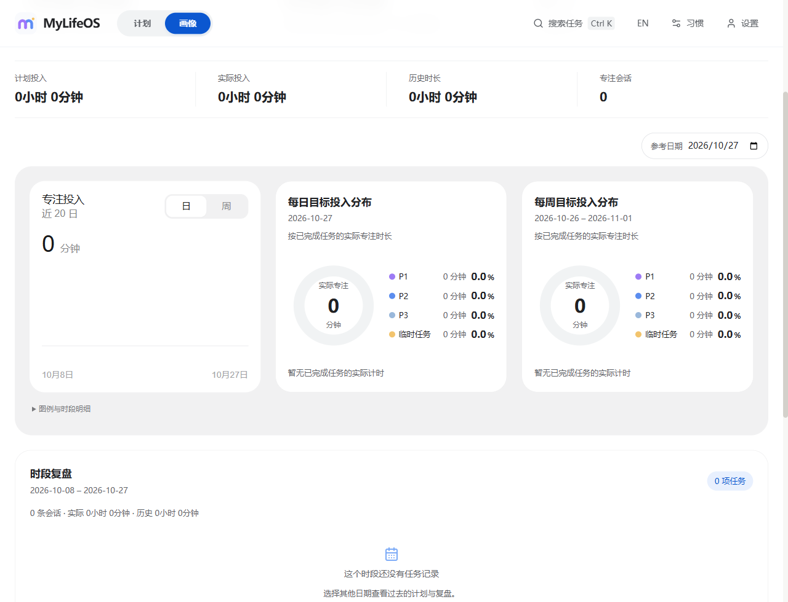

# MyLifeOS

[English](README.md) | [简体中文](README.zh-CN.md)

MyLifeOS is an offline productivity app for Windows and Android, built with React and TypeScript, Electron on desktop, and Capacitor on Android. It combines habit rules, daily tasks, timeline scheduling, focus sessions, and profile statistics. A browser preview is also available, with separate browser-local data.

The shared source and the earlier Android personal APK are version **0.1.10**, but they are not the same build. The APK was built on 2026-10-26, before the 2026-10-27 scheduling and profile-layout changes. The latest source has not been packaged into a new Android APK or Windows installer; installed applications are not updated automatically.

## What it does

- Define habits with priority, quota, duration, date range, and daily/weekday/custom-day repetition; generate daily tasks from those rules
- Create one-time tasks without a priority; existing and imported one-time tasks use the same yellow category
- Schedule by clicking or dragging tasks onto the timeline, with conflict detection; Windows and Android use a **30-minute** scheduling grid
- Start focus directly from today's unfinished Inbox or scheduled tasks while preserving their schedule
- Search tasks; on Windows, move unfinished one-time tasks together to another date and undo up to 20 task operations during the current run
- Switch between Inbox and Timeline in narrow windows and on phones
- Run native focus timers on Windows and Android, with pause, resume, stop, and recovery; display focus/rest countdowns and accumulated durations in **minutes** while keeping measured timing precision internally
- Save completion before offering Start break / Back to planner; retain failed changes for retry or export
- Fill completed task cards with their category color and dark text over **800 ms**; completed cards cannot restart focus
- Review measured focus, legacy estimates, daily and weekly distributions, task notes, and yearly activity
- Export full **v8** backups, import v1–v8, and explicitly export v7 for the earlier Android 0.1.4 APK or v6 for Windows 0.1.3

## Latest Windows interface

The planner keeps its Inbox and timeline layout, with a pure white canvas, blue primary controls, rounded panels, and consistent typography. Category colors are P1 purple, P2 blue, P3 light blue, and one-time tasks yellow. Task and habit duration fields can be cleared before entering a new value.

Scheduling uses a 30-minute grid on Windows and Android. Previous 5- or 15-minute preferences become 30 minutes on load or backup import; already scheduled task start times remain unchanged. Ctrl+K opens search, Ctrl+J opens the current session, and Ctrl+Z undoes task operations outside inputs and dialogs. The deletion toast also supports undo for ten seconds.

Completed cards no longer respond to clicks, Enter/Space, or dragging to restart or reschedule them. Notes/reviews and deletion remain available through their own buttons. The 800 ms color transition respects reduced-motion settings. Countdown minutes round up until the timer ends; accumulated time displays whole elapsed minutes. Internal timestamps and measured session records retain their precision.

The current Windows/browser Profile page follows the same white-and-blue style. At desktop widths of at least 1280 CSS pixels, the focus history, daily distribution, and weekly distribution appear in one row; the two distribution cards match the history card's height. Narrower layouts wrap or stack the cards. The reference-date control remains above them; the former weekly-target progress card has been removed.

- The **focus history** switches between the latest 20 days and 20 Monday-based weeks. Stacked colored bars show measured focus by category; red bars below the baseline show `max(planned − measured, 0)`. The expandable legend and table show planned, measured, historical-estimate, and shortfall figures.
- **Daily and weekly goal distributions** use thick, rounded ring segments separated by white gaps. Colors are weighted by **actual measured focus time associated with currently completed tasks**, rather than task counts or planned duration. The center shows total minutes; the legend shows each category's duration and percentage.
- The daily ring uses the selected reference date; the weekly ring uses that date's local Monday–Sunday week. A completed task's earlier stopped sessions count toward its ring. Unfinished, undone, deleted, unmatched, and estimated records do not contribute to the rings.
- Measured totals include completed and stopped focus, excluding pauses and breaks; legacy estimates remain separate. Cross-midnight sessions belong to their original task date. The weekly-target setting remains in preferences, but the current Profile page no longer shows its progress card.
- Period review follows the selected history range and displays task notes, review notes, and related sessions, with 25 tasks per page.
- The annual heatmap uses shades of blue and a centered, compact grid, with cells around 16 px and 2 px gaps on desktop. Narrow windows can scroll within the chart. Android uses the same measured-focus data and profile components with a responsive mobile layout.

These presentation changes preserve the native timer interfaces and backup schema. They do not install or update an existing app.

## Screenshots

Design review additions on 2026-10-14: create tasks directly from the empty inbox; show a scheduling hint on unfinished inbox cards; distinguish notes from reviews; label total planned duration as “计划投入” in Chinese; and jump to the current time from the desktop timeline. Task creation focuses the name field, scheduling and review dialogs have accessible names and close-button labels, and narrow 320px windows and the English header have improved wrapping. The [screenshot audit and validation record](docs/product-design-audit/REPORT.md) covers the local browser preview only, not an installed-app update or native-device acceptance.

The current Profile screenshot is a browser preview with no measured focus records. The annual-activity screenshot below uses isolated fictional data and shows an earlier layout.

### Planner: historical reference

The [2026-10-08 planner screenshot](docs/manual-task-priority/planner.png) is retained as a historical reference. It uses the old red P1 and purple one-time-task colors. Current colors are P1 purple, P2 blue, P3 light blue, and one-time tasks yellow, as described above.

### Profile: focus history and daily/weekly distributions



### Annual focus activity


## Tech stack

- React 18
- TypeScript
- Vite and Vitest
- Electron
- Capacitor 8 for Android
- Local file storage in Electron `userData`
- Atomic JSON snapshots in Android app-private storage, with an independent previous valid copy
- Browser fallback storage for non-Electron runs

## Main app flow

1. Create or update habits in the habit config panel.
2. Open a day and let the app reconcile tasks from current habit rules.
3. Move inbox tasks onto the timeline.
4. Select Start focus on one of today's unfinished tasks in the Inbox or timeline.
5. Wait for the completion to save, then choose Start break or Back to planner. A failed save retains the task and recovery options.
6. Review focus statistics and back up data in Settings → Data Management.

See the [English user guide](USER_GUIDE.en.md) or [中文使用指南](USER_GUIDE.md) for platform-specific steps.

## Key directories

- [src/App.tsx](src/App.tsx): top-level layout and page composition
- [src/hooks/useAppController.ts](src/hooks/useAppController.ts): unified app state and user actions
- [src/components](src/components): UI building blocks
- [src/services/storage.ts](src/services/storage.ts): storage facade and profile stats helpers
- [src/services/storage](src/services/storage): repositories, task planning, backup import/export
- [src/services/electronIPC.ts](src/services/electronIPC.ts): renderer-side Electron bridge wrapper
- [src/services/platform.ts](src/services/platform.ts): platform selection
- [src/services/nativeRuntime.ts](src/services/nativeRuntime.ts): Android snapshot queue, save status, recovery, and timer operations
- [android/app/src/main/java/com/mylifeos/app](android/app/src/main/java/com/mylifeos/app): Android storage, reminders, and background completion
- [src/services/scheduling.ts](src/services/scheduling.ts): timeline slots and overlap detection
- [src/main/electron.ts](src/main/electron.ts): main process, secure IPC, timer runtime, desktop storage, tray, and window lifecycle
- [src/main/preload.ts](src/main/preload.ts): whitelisted bridge exposed to the renderer

## Development

Use Node.js 22.12.0 or newer. Desktop release builds target Windows x64 with
Electron 44.4.2 and electron-builder 26.16.1.

Install dependencies:

```bash
npm ci
```

Start the browser preview:

```bash
npm start
```

Keep the process running and open [http://127.0.0.1:3000](http://127.0.0.1:3000). Do not double-click `index.html`: Vite resolves its source entry through the development server. Browser data is separate from Windows and Android data, and browser timing does not provide native background guarantees.

Start web + Electron in development:

```bash
npm run electron:dev
```

Run the desktop app from a production web build:

```bash
npm run build
npm run prod
```

Windows launcher and shortcut instructions are in the user guides. The launcher checks source fingerprints and commits for both frontend/main builds and rebuilds both when missing or stale.

Run the quality gate:

```bash
npm run verify:release
```

Build the Windows desktop app:

```bash
npm run electron:build
```

Windows candidates are written to `out/windows/<version>/`; existing executables and shortcuts are untouched. Packaging also runs the startup and
functional packaged-app regression checks; see the release checklist for coverage
and network mirror setup.

## Release checks

See [RELEASE_CHECKS.md](RELEASE_CHECKS.md). To validate shared code and Android compilation without signing a personal release or installing on a device, use JDK 21 and the Android SDK with:

```bash
npm run android:verify:compile
```

Latest shared-source verification (2026-10-27, application source commit `037ace2`): `npm run verify:release` passed: **304 tests across 45 files**, frontend and Electron type checks, the production web build, and Electron main-process build. The three-card layout and day/week controls were checked in a browser; this does not constitute installed Windows or Android device acceptance.

Earlier Android release validation (2026-10-26, 0.1.10): **299 shared tests across 45 files**, frontend and Electron type checks, production build, Capacitor sync, **25 native JVM tests**, Release Lint (**0 errors, 32 warnings**), signed release APK and instrumentation-test APK compilation passed. The certificate matches the 0.1.9 APK. Browser checks used a simulated Android bridge at 360, 412 and 480 CSS pixels. Instrumentation tests and installed upgrades have not been executed on a phone or emulator for this release.

Earlier source validation (2026-10-11):

- The Windows UI changes were merged into main in [PR #5](https://github.com/landonnorris1027-dev/MylifeOS/pull/5), merge commit `3dee7d3`. Its [main Windows candidate run](https://github.com/landonnorris1027-dev/MylifeOS/actions/runs/38121511322) passed.
- Android compile-only verification of integration commit `43948b3` (the same application source tree as `3dee7d3`) passed: **273 shared tests across 40 files**, frontend and Electron type checks, production build, Capacitor sync, **13 native JVM tests**, Debug Lint, and compilation of the debug APK and instrumentation-test APK.
- Instrumentation tests were compiled, not executed. Phone acceptance and a new personal APK release remain pending. Source validation does not update an installed Windows or Android app.

These results describe those commits; use the Actions run and verification metadata for the checkout being tested. The earlier personal APK's results are listed separately below.

## Android personal APK

The Android app requires **Android 7 or later** (min SDK 24; target SDK 36). The locally generated `out/android/MyLifeOS-0.1.10-personal.apk` is the 2026-10-26 build and predates the latest source changes described above. To use those changes on a phone, build a new APK first. Back up the old app before an in-place update and use the same signing identity; installed-upgrade data preservation has not yet been verified on a device.

Windows source, Android, and the browser share business code through a platform adapter. New source builds export v8 with focus sessions and scheduling precision. The earlier personal Android 0.1.4 APK uses v7; export v7 explicitly when exchanging with that build. In Android Settings → Data Management, use **Export for desktop 0.1.3 (v6)** to exchange files with desktop 0.1.3; vibration is omitted. Compatibility exports omit measured focus-session records and scheduling precision; one-time tasks are represented as P3 for older clients. Keep a full v8 backup as well. **Share full backup** does not confirm a saved backup file. Active, paused or pending focus sessions must be ended or explicitly abandoned before import/restore, which also creates a pre-operation backup.

Build with Node.js 22.12+, JDK 21, SDK/Build Tools 36, and the preserved personal signing key:

```bash
npm run android:verify
```

Set `JAVA_HOME`, `ANDROID_HOME`, and, when needed, `MYLIFEOS_KEYSTORE` as described in [Android implementation](docs/android/IMPLEMENTATION.md). The entry checks types, shared tests, production build, native JVM tests, Lint, APK signature/manifest, and compiles instrumentation tests. It does not install on a phone.

Outputs are `out/android/MyLifeOS-0.1.10-personal.apk` and `out/android/verification.json`. The APK uses the old certificate identity with debugging disabled; metadata records its source commit, version, certificate, SHA-256, and checks. Generated APKs and the private signing key are not committed to Git.

The `b2164cb` build passed **143 shared tests and 10 native JVM tests**; Release Lint reported **0 errors and 19 warnings**. Instrumentation tests were compiled but not executed. Android 7/13/16, installed upgrade, lock-screen/reboot/battery behavior, and full phone interaction remain pending; see [validation and device acceptance](docs/android/VALIDATION.md). These results are tied to that build, rather than a guarantee for every later checkout.

## Extra docs

Duration Picker and Delete Button are adapted from [Rare UI](https://rareui.com), by Swami Malode. See [third-party notices](THIRD_PARTY_NOTICES.md) for the license and source details.

- [English user guide](USER_GUIDE.en.md)
- [中文使用指南](USER_GUIDE.md)
- [Architecture](docs/ARCHITECTURE.md)
- [Data flow](docs/DATA_FLOW.md)
- [Dependency upgrade research](docs/DEPENDENCY_UPGRADE_RESEARCH.md)
- [Windows implementation and acceptance](docs/WINDOWS_IMPROVEMENTS.md)
- [Minute display and legacy scheduling compatibility](docs/MINUTE_DISPLAY.md)
- [One-time task priority compatibility](docs/MANUAL_TASK_PRIORITY.md)
- [Completion motion and interaction evidence](docs/TASK_COMPLETION_MOTION.md)
- [Profile chart design and validation evidence](docs/PROFILE_UI.md)

Implementation records include historical stage results; the current behavior and source validation are summarized above.
