# MyLifeOS 设计评审与优化

日期：2026-10-14。分支：`codex/product-design-clarity`。

本次使用 Product Design 的 audit 流程，以当前源码启动的独立浏览器预览为证据。浏览器使用虚构任务；没有读取已安装应用的数据。范围为计划页的添加、排期、专注、笔记与复盘，以及窄窗口和画像页入口。沿用白底、蓝色控件、原有标签色与布局。

## 结论

主要问题是操作入口与状态文字：首次打开没有就近的新建入口；卡片可以排期但缺少提示；仅有笔记也被标为“已复盘”；包含待办的计划总时长被标为“已安排”。本次已修正这些问题，并补充桌面时间线跳转、弹窗名称与关闭按钮标签，以及窄窗口排版。

整体优势是计划与画像导航明确、任务标题与时长集中、专注模式突出主要操作、排期提供推荐时间与冲突说明。适合在现有设计基础上继续改进。

## 逐步检查

### 1. 首次打开计划页 — 已优化

原画面的空待办池只提示“添加一项任务”，附近唯一的操作是添加习惯；新用户需要转向右上角找新增任务。现在在空状态中直接提供蓝色新增按钮，同时将“已清空”改为更适合首次打开的“暂时没有待办”。

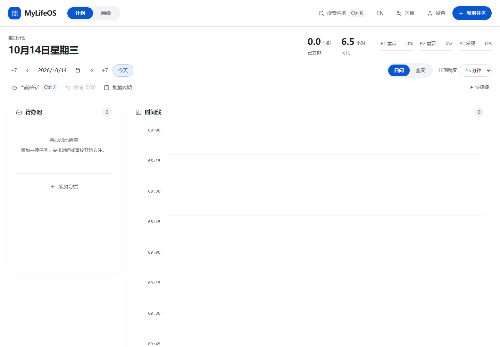
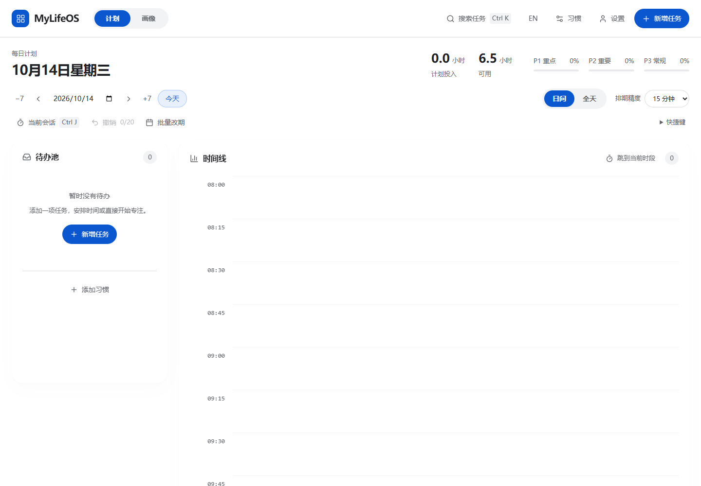

### 2. 新建临时任务 — 已优化，表单对比度仍可继续检查

原弹窗打开后键盘焦点位于关闭按钮。现在直接聚焦任务名称，名称设为必填，并为弹窗提供“临时任务”的名称。使用空待办池的新入口成功打开表单并创建任务。表单字段的灰色说明仍较浅；本次没有进行完整的对比度和屏幕阅读器验收。

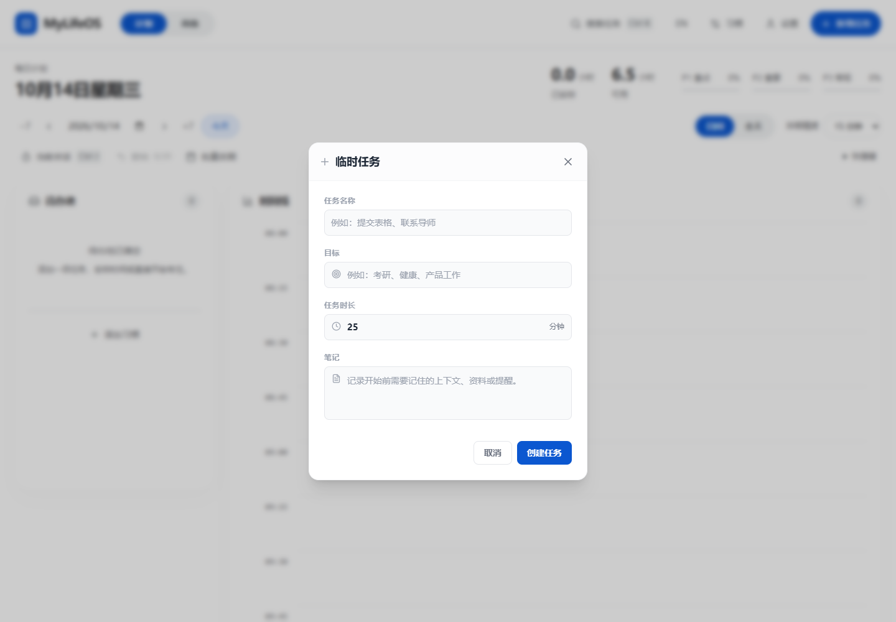
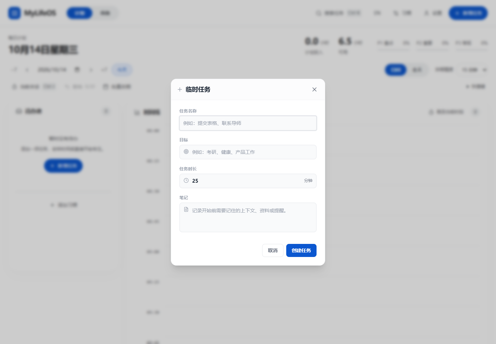

### 3. 查看待办并选择下一步 — 已优化

用相同名称、25分钟时长和仅有笔记的虚构任务做前后比较。原卡片显示“已复盘”，且只有开始专注按钮，卡片本体的排期行为不明显。现在仅有笔记显示“有笔记”，有非空复盘才显示“已复盘”；未完成待办卡片增加“点击卡片安排时间”的文字提示。卡片点击、Enter／空格键与拖拽行为继续使用原有操作。

中文总时长标签改为“计划投入”，因为该数值包含待办、已排期和已完成任务的计划时长，不等于已经安排到时间线的时长。计算口径未改变。

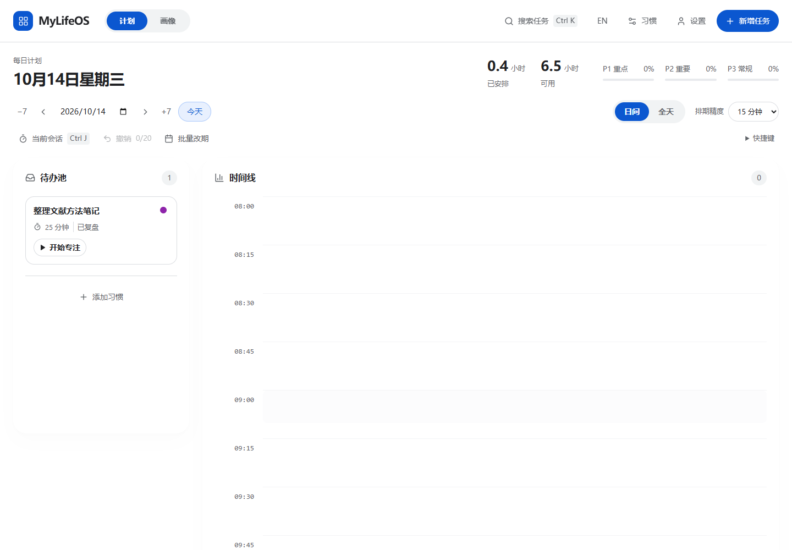
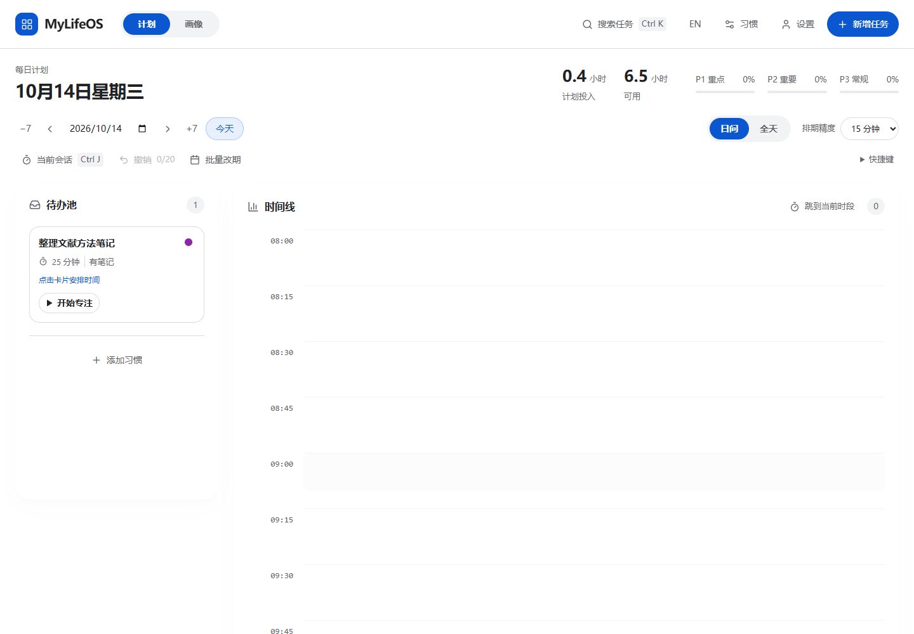

### 4. 安排时间并定位当前时段 — 已优化，排期列表仍有简化机会

推荐时间与冲突说明保留；点击推荐时间成功把任务保存为已排期，随后移出时间线也成功。排期弹窗与关闭按钮有明确名称。桌面时间线增加“跳到当前时段”，实际点击后17点附近的时间槽进入视口，减少从08:00开始的长距离滚动。

原排期列表把已过去的时段也用红色呈现，容易与冲突混淆；“最佳选择”与“最早可安排时间”重复。这两点作为后续机会记录，本次保持现有排期逻辑和选择结构。

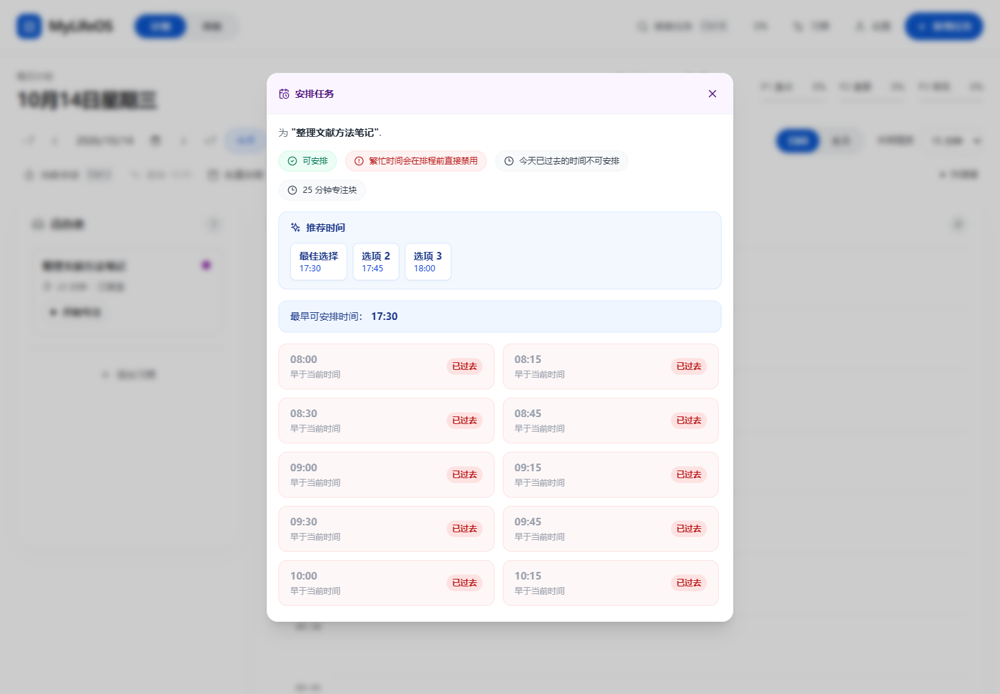
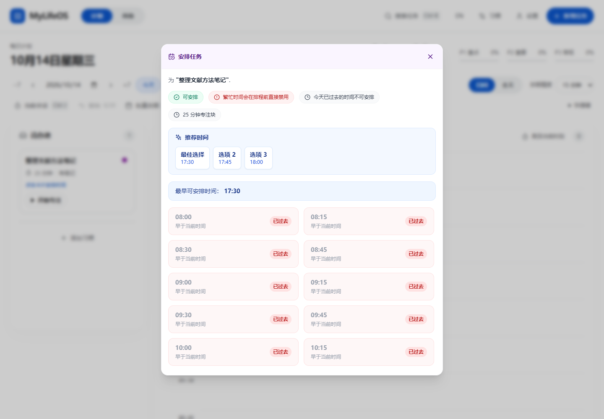
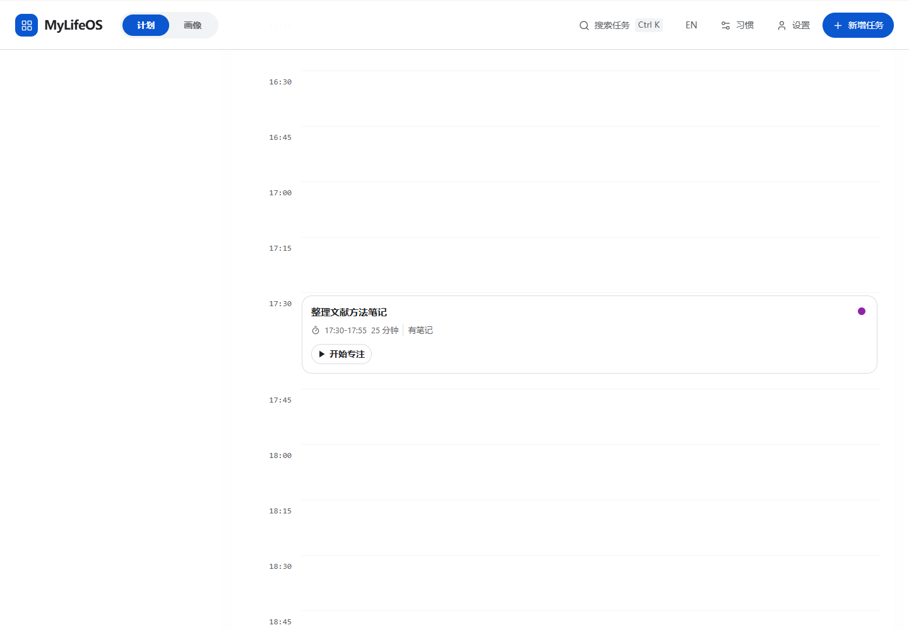

### 5. 进入专注 — 主要操作清楚

直接开始专注后，可见任务名称、分钟倒计时、暂停和提前完成。用虚构任务执行了提前完成操作，并看到了完成反馈。此步骤未修改。浏览器预览不具备原生计时器的后台保证，不能据此声称 Windows／Android 后台计时或保存恢复已验收。

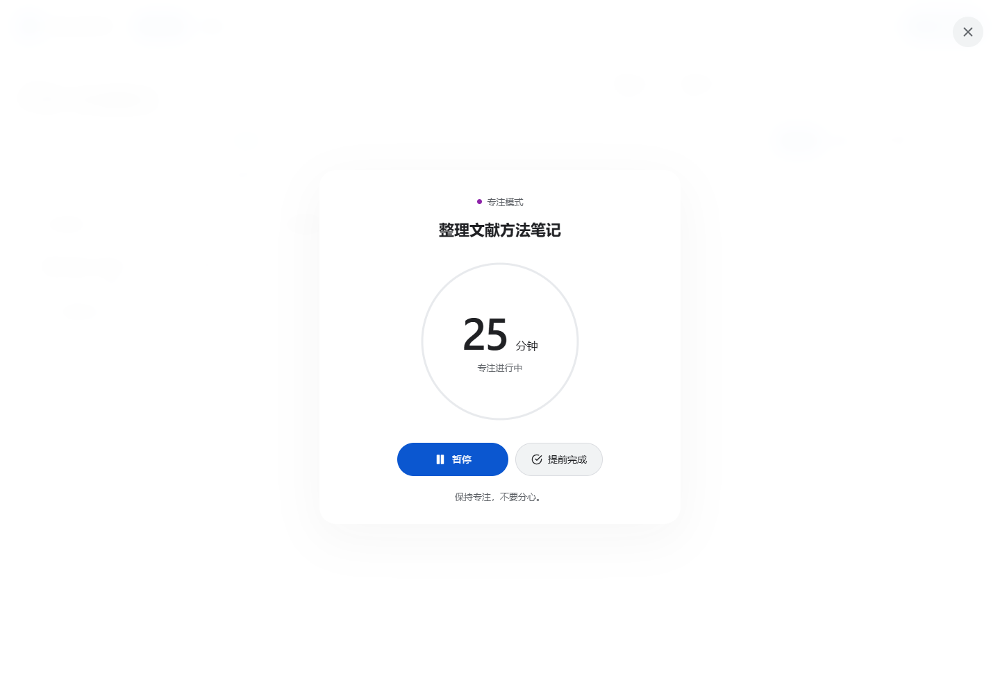

### 6. 编辑笔记与复盘 — 已优化

笔记与复盘保持两个独立字段。弹窗补充名称，关闭按钮补充“关闭”标签。实际填写并保存复盘后，卡片标签变为“已复盘”；排期状态下不显示待办卡片的排期提示。

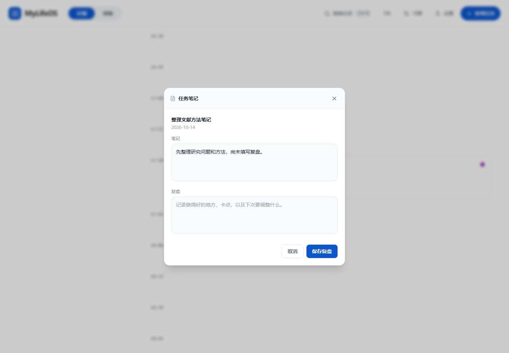

### 7. 窄窗口与画像入口 — 已验证本次布局，原生与辅助技术仍待验收

390px宽度下待办池／时间线切换正常，画像页可访问。320px检查发现顶部工具文字和日期拥挤：现在减少主导航内边距、在最窄窗口使用有名称的图标工具，并使日期标题单独成行。英文顶部工具栏减少左右留白并避免词语与语言按钮换行。

中文计划页在320／390／768／900／1280／1440px宽度下，文档宽度等于视口宽度，没有页面水平溢出。英文390px同样没有页面水平溢出。上述宽度检查不等于全部页面、所有数据量或真实触摸设备验收。

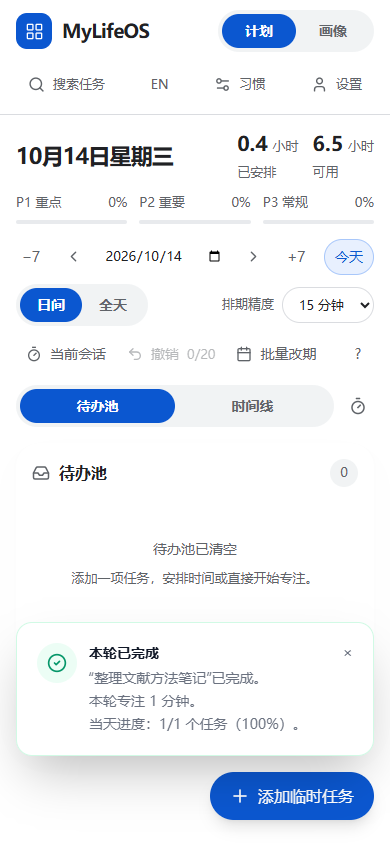
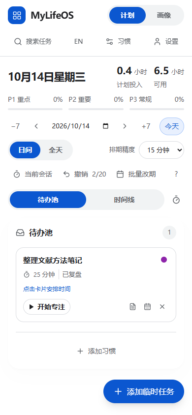
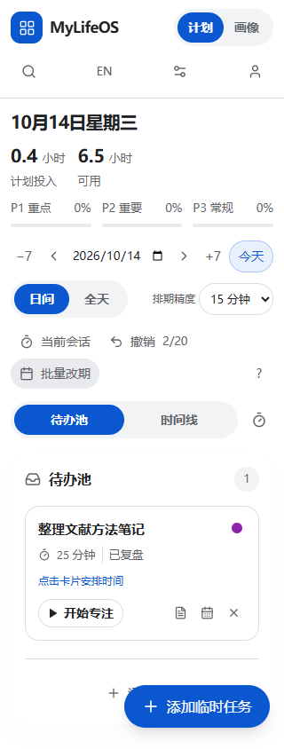
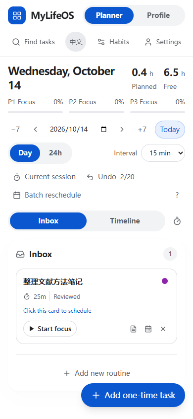
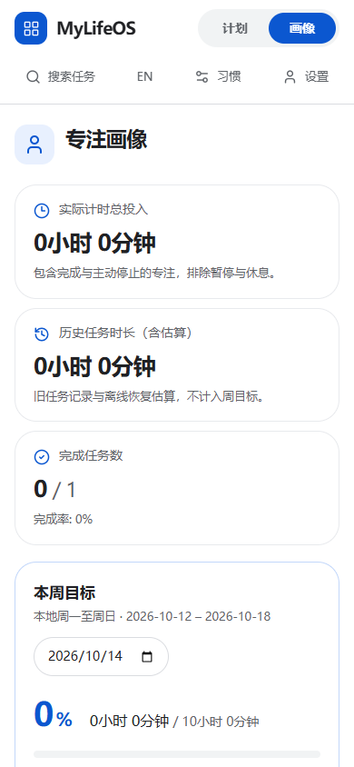

## 验证与范围

- `npm run typecheck`：通过。
- `npm test`：40个文件、273项测试通过。沙箱运行最初受到依赖访问和临时文件重命名限制；在沙箱外重新运行通过。
- 最终笔记空白边界处理后，重新运行4个相关组件测试文件，18项测试通过；类型检查和生产构建再次通过。
- `npm run build`：通过；覆盖本次前端生产构建。
- 浏览器操作：空待办新增入口、创建任务、名称焦点、卡片排期、保存推荐时间、跳到当前时段、保存复盘、移出时间线、导航与语言切换均已执行。
- 本次截图均在当前检查中捕获并打开查看；前后对照页见 [index.html](index.html)。截图展示实际浏览器状态，未用生成图替代。
- 未执行安装包构建、安装、Android编译、真实设备、屏幕阅读器或完整WCAG验收；未修改备份格式、数据模型、存储和原生计时接口。
- 浏览器控制台只观察到开发预览的 `favicon.ico` 404，没有本次操作中的应用脚本错误。该图标问题未纳入本次修改。

## 建议后续优先级

1. 简化排期列表：区分已过去、冲突和跨日状态，减少重复推荐。
2. 对表单说明、完成卡片和图表做完整对比度及屏幕阅读器检查；当前可点击卡片内嵌操作按钮的语义也需要单独评估。
3. 用密集任务和真实触摸设备继续检查固定新增按钮、弹窗高度与时间线滚动。

以上为后续建议，没有扩展为本次实现。
