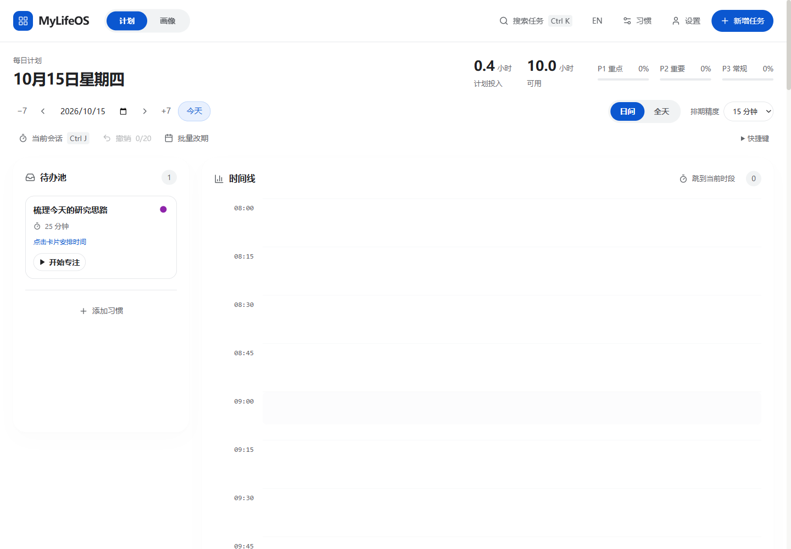
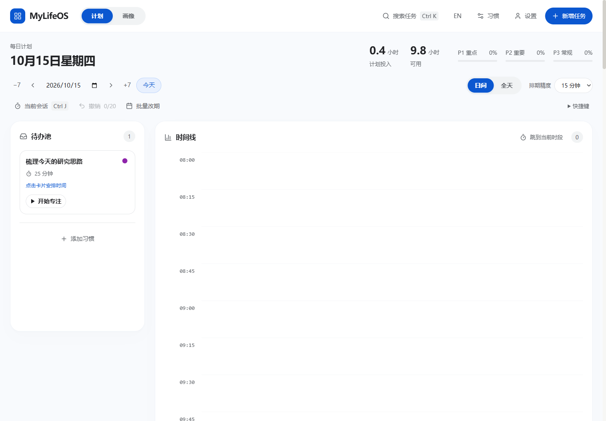
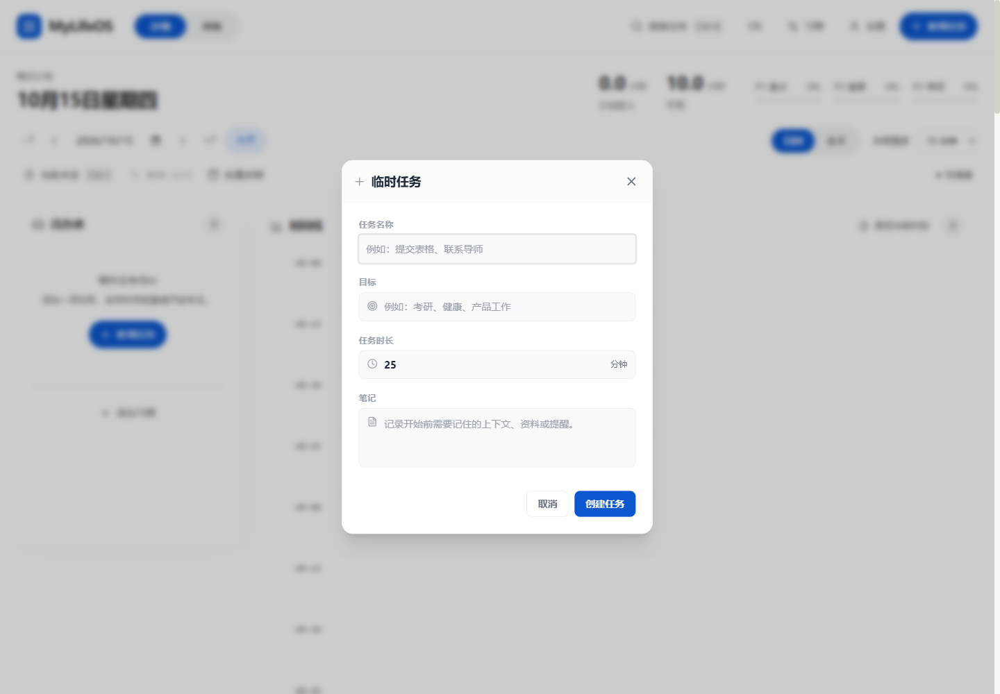
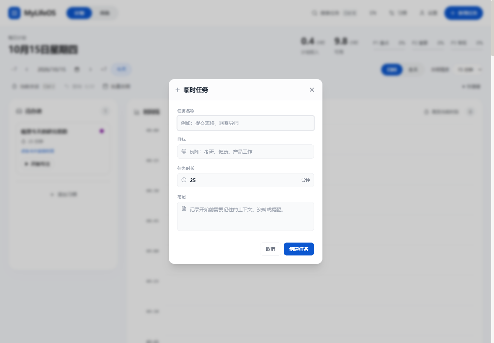
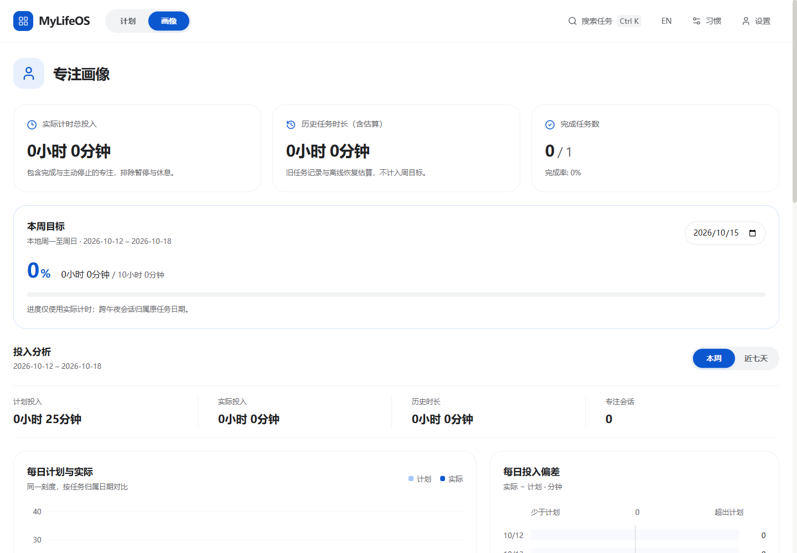
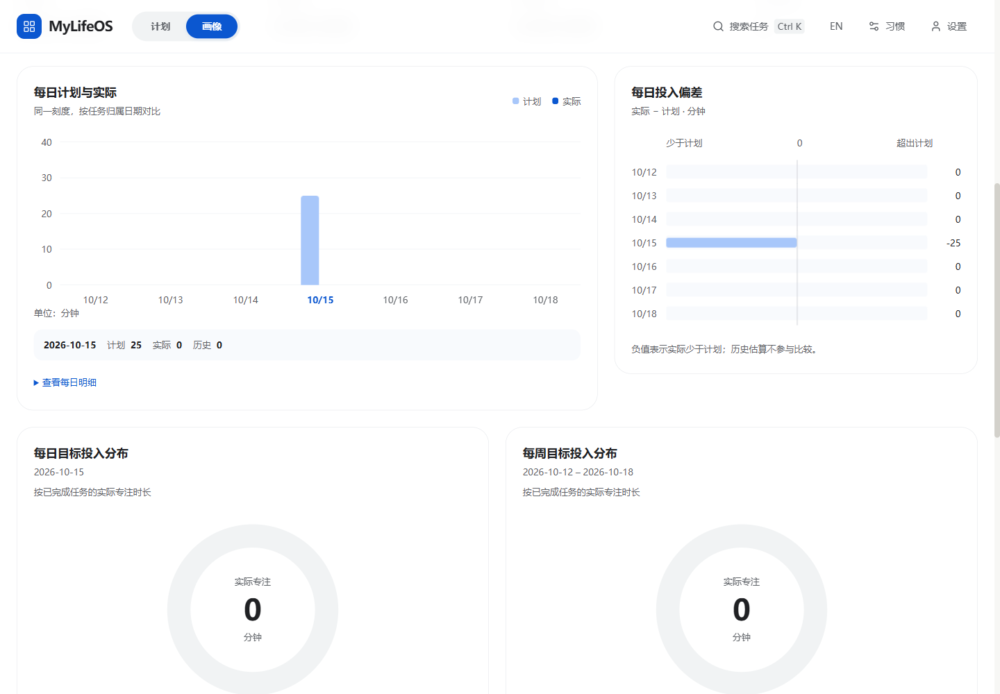
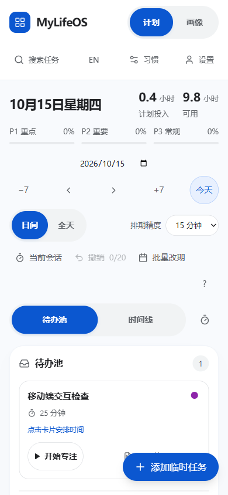
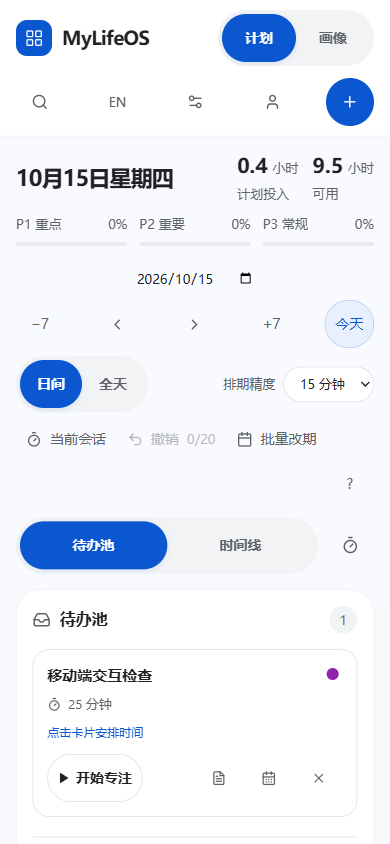

# MyLifeOS 点击与滚动动效优化

日期：2026-10-15。分支：`codex/fluid-interactions`。起点：`3d84379`。

使用 Product Design，以当前项目和实际浏览器画面为设计依据。沿用白蓝配色、Lucide 图标和现有页面结构；计划页增加浅色画布与细边框，帮助区分卡片层次。全部截图来自本次隔离浏览器预览，任务均为虚构数据。

## 检查与实现

| 步骤 | 原画面与交互发现 | 最终表现与检查结果 |
| --- | --- | --- |
| 1. 计划页与按钮 | 主要按钮只有简单按压反馈，任务悬停变色也使用了完成状态的 800ms 时长。 | 按下即时反馈，释放时轻微回弹；悬停变色缩短为 160ms。任务完成状态继续使用渐进变色。 |
| 2. 导航、日期与卡片 | 页面切换缺少衔接，删除任务后的列表位置直接改变。 | 导航选中块带轻微回弹；页面与日期内容渐入；任务移除、排期和撤回后按位置差异平滑补位。浏览器捕获到补位动画运行，时长 380ms；撤销恢复成功。 |
| 3. 弹窗开合 | 新建、排期等常用弹窗关闭时直接消失。 | 10 个弹窗组件共享入场和退出行为：面板入场 360ms，退出保留最多 180ms。关闭立即返回焦点，并将退出内容设为 `inert` 和 `aria-hidden`；连续关闭重开通过。 |
| 4. 滚动与画像 | 时间线和画像各区域出现时缺少连贯感。 | 浏览器原生滚动配合首次进入视野的渐入，最多 140ms 的错开时序；画像柱图和周进度有过渡，专注运行状态有轻微呼吸提示。跳转当前时段与滚动后的可见性通过。 |
| 5. 手机端与辅助设置 | 390px 触摸模拟中，浮动新增按钮覆盖任务操作；加入顶部入口后，英文工具文字需要收紧。 | 新增改为顶部常驻蓝色加号，手机工具栏用带名称的图标；新增与专注按钮均达到 48px。中文 320/390/768/900/1440px、英文 390px 均按实际可用视口检查，无页面水平溢出。 |

## 前后画面对照

桌面截图均为 1440×1000。时钟在检查过程中继续运行，“可用时长”因此可能变化；截图中的可用时长差异不能用于推断计算逻辑变化。

### 1. 计划页任务卡片

优化前：

优化后：

### 2. 新建任务弹窗

优化前：

优化后稳定状态：

[入场中间帧](06-dialog-in-motion.png) 为浏览器真实动画暂停在 120ms 时捕获的画面，用于检查透明度和位移；不是稳定状态截图。

### 3. 画像与滚动

静态截图只能说明布局与可见性。页面切换、弹窗和滚动的实际运行状态另存于 [验证记录](verification.json)。

### 4. 手机端新增入口

调整前，390×844 触摸模拟中的浮动按钮覆盖卡片操作：

调整后，新增放在顶部，卡片操作可完整显示：

其他布局检查截图：[中文待办池](10-after-mobile-inbox.png)、[中文时间线](11-after-mobile-timeline.png)、[英文待办池](12-after-mobile-en.png)。

## 验证

- `npm run typecheck`：通过。
- `npm test`：41 个文件、283 项测试通过。新增覆盖退出期间立即释放焦点、关闭视图不可交互、快速重开、动态切换减少动画偏好、退出清理和滚动行为；补充嵌套确认框与退出视图的 Escape 检查。
- `npm run build`：通过。
- `git diff --check`：通过。
- 浏览器：新建虚构任务、排期、移出时间线、打开及关闭笔记、删除、撤销恢复、导航、弹窗快速重开、原生滚动、当前时段跳转、中英文窄屏和触摸点击通过。
- 弹窗打开时滚轮操作没有带动背景页面；关闭立即恢复到新增按钮的焦点。
- 减少动画模式下，页面切换后运行中的动画数量为 0、画像没有隐藏内容，弹窗立即卸载；导航选中位置仍正确。
- 模拟缺少 Intersection Observer 与 Web Animations 时，64 个时间线行仍可显示，待呈现标记与不可见行均为 0。
- 动画使用一次性呈现观察器和委托点击反馈；没有拦截滚轮，也没有逐帧触发 React 状态更新。短时帧采样保存在 JSON，仅代表本次本机采样，不能推断其他设备的性能。

首次沙箱测试受到临时模块读取和文件重命名权限限制；同一套测试在允许的非沙箱环境中通过。没有把环境失败计为验证通过。

本次验证覆盖 Chromium 开发预览和移动触摸模拟。Windows 安装包、Android 真机、屏幕阅读器与完整无障碍合规尚未验收。

## 实现入口

- `src/hooks/useMotionScope.ts`：委托点击反馈、滚动呈现与卡片位置过渡。
- `src/hooks/useMotionPresence.ts`：保留短暂退出画面，立即禁用交互。
- `src/hooks/useReducedMotion.ts`：动态偏好监听及尊重偏好的滚动跳转。
- `src/components/MotionScene.tsx`：页面切换过渡，保持组件正常状态更新。
- `src/ui-motion.css`、`src/profile.css`、`src/components/TaskCard.css`：节奏、悬停、弹窗、图表及触摸样式。

逐项浏览器结果与实际 DOM 快照见 [verification.json](verification.json)。可重放的本机检查片段保留在忽略目录 `output/playwright/ui-motion/fluid-interactions/`。
