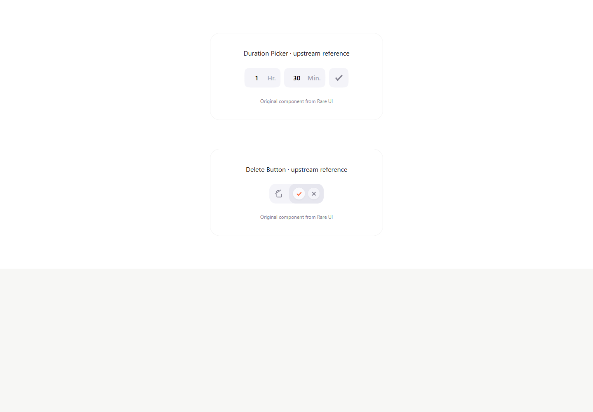
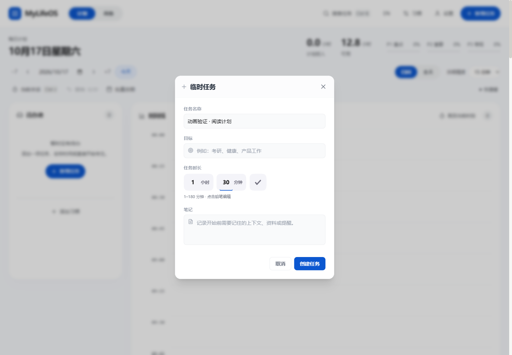
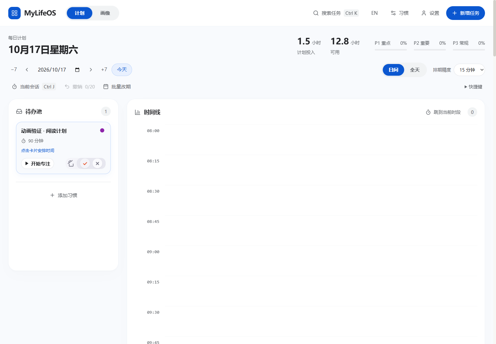
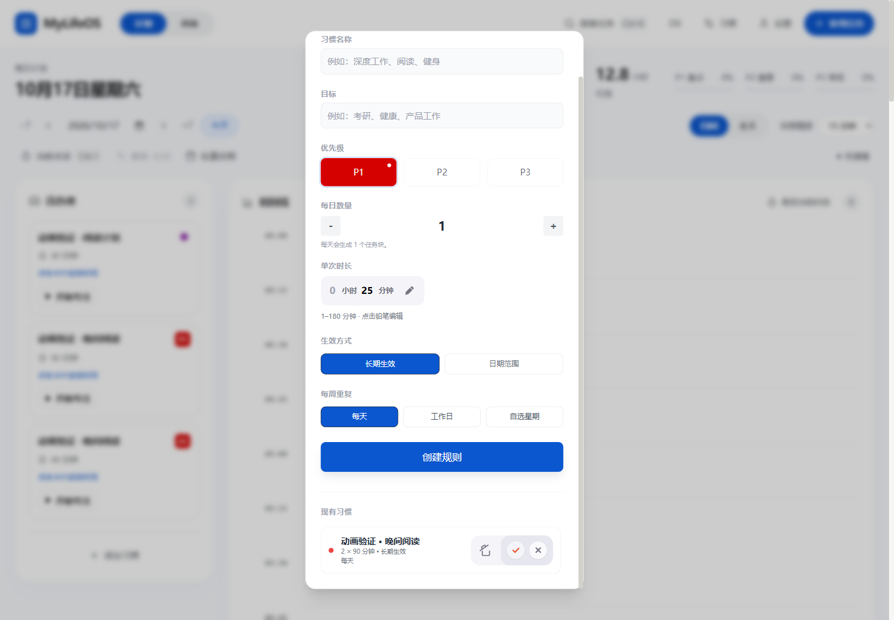
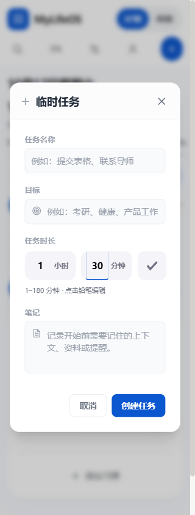
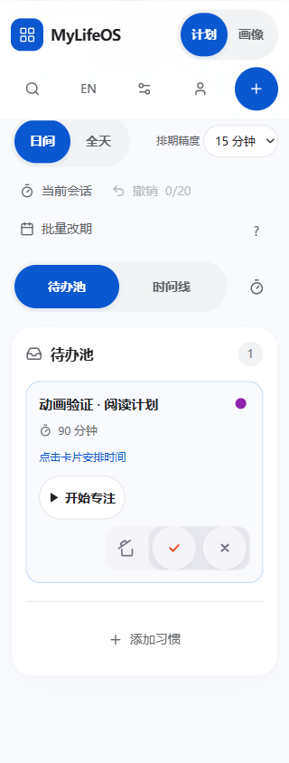

# Rare UI 时长与删除交互适配

日期：2026-10-17。项目唯一目录 `D:\考研\69b2\MylifeOS-main`，分支 `codex/fluid-interactions`。沿用本分支已有页面切换、滚动渐入、卡片补位和弹窗动效。

[本地预览](http://127.0.0.1:3100/) · [完整设计 QA](../../../design-qa.md) · [第三方许可](../../../THIRD_PARTY_NOTICES.md) · [验证摘要](verification.json)

## 已实现

| 组件 | 应用位置 | 视觉与动效 | 应用行为 |
| --- | --- | --- | --- |
| Duration Picker | 临时任务时长、习惯单次时长 | 灰紫胶囊分段展开、弹簧间距、数值轻摆、铅笔变勾号 | 小时/分钟合成总分钟；1–180 分钟；可清空再输入；Escape 回退；保留外部值同步 |
| Delete Button | 当天任务删除、减少习惯每日数量、习惯规则删除 | 桶盖打开、桶体收拢、确认/取消面板滑出、按压回弹 | 首击仅展开；Escape/外部点击取消；等待时防重复；失败可重试；原有撤销和数量规则保留 |

组件适配作者[公开源码固定版本](https://github.com/swamimalode07/rare-ui/tree/9633fcfa81c212a0ba48507e9c56be4869d61928/components/ui)。线上演示返回 429，因此参考截图来自在本地运行的原始组件。源码版权和完整许可已保留，两个 README 已署名链接。

## 参考与实际画面

原始组件展开：

任务时长：

任务删除：

习惯规则删除：

手机窄屏时长与触屏删除：

## 验证结果与边界

类型检查、42 文件 / 291 项测试、生产构建通过。浏览器验证了临时任务与习惯保存 90 分钟、删除取消/撤销、减少每日数量和删除规则；所有测试数据均为独立浏览器上下文中的虚构任务。

320/390/768/1440px 及英文 390px 无横向溢出，触屏删除按钮为 48×48px，动态 reduced-motion 切换通过。设计 QA 修正并复拍了蒙版尺寸、桌面确认间距和关闭面板溢出问题。

生产构建有 legacy 主包体积提示，详见完整 QA。未验证 Windows 安装包或 Android 真机，未部署、推送或创建新的工作树。
